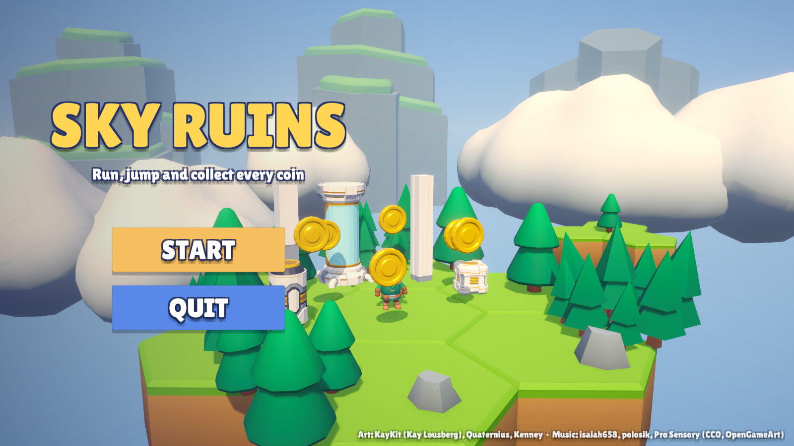
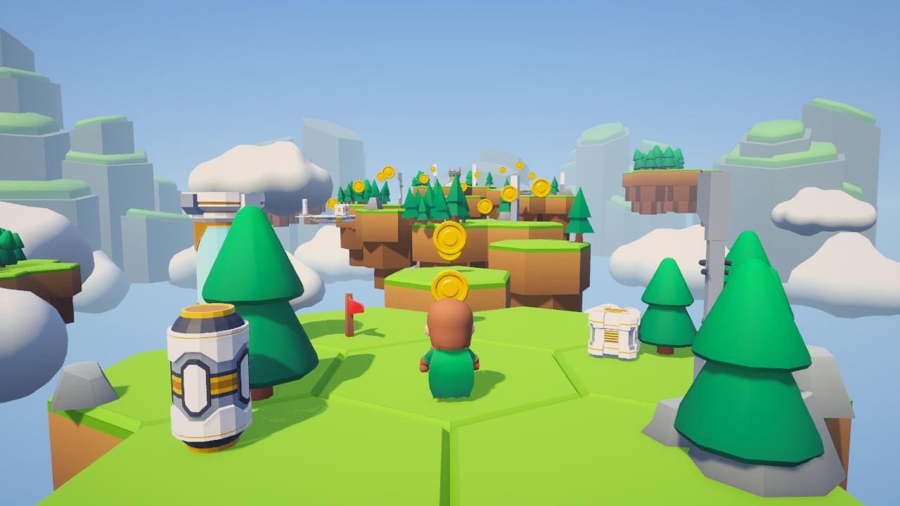
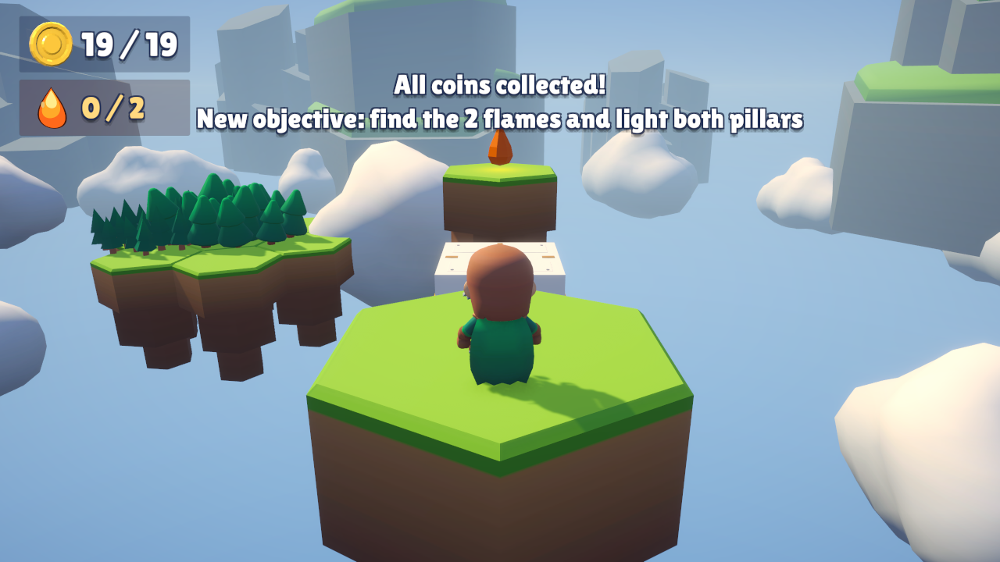
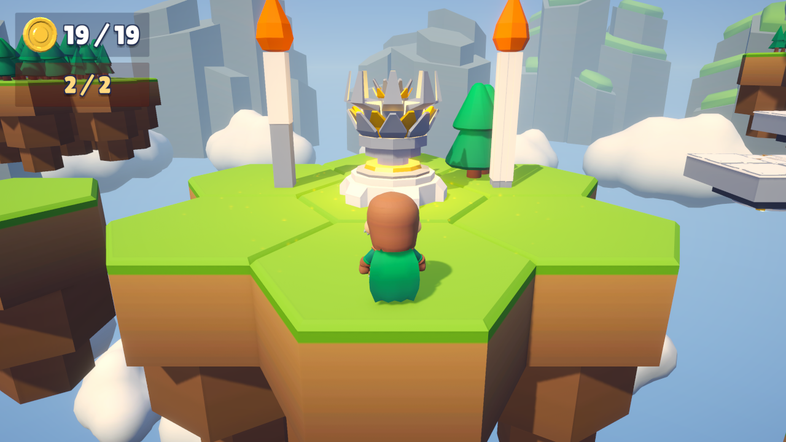
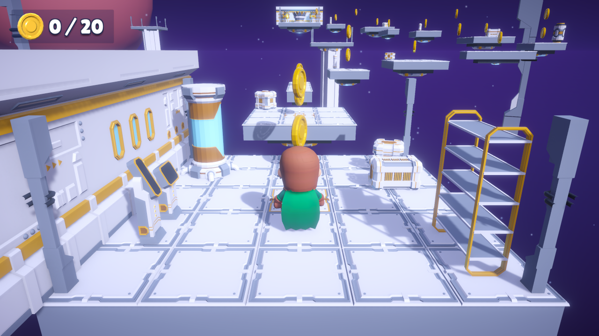
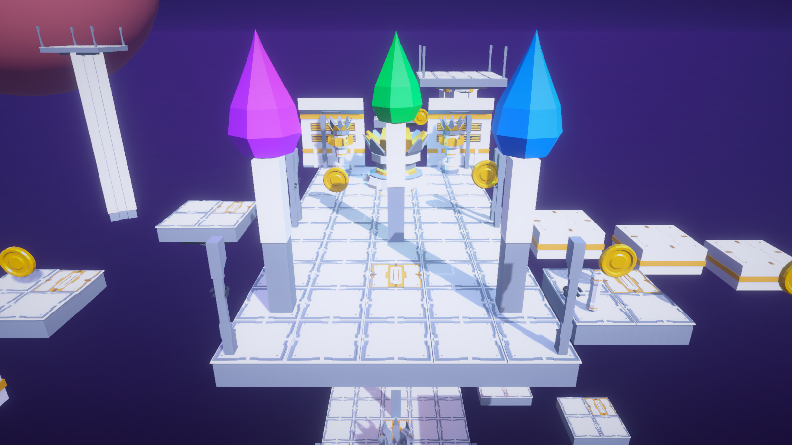
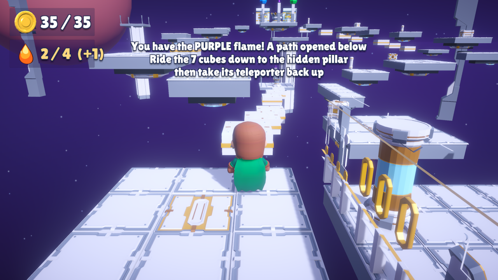
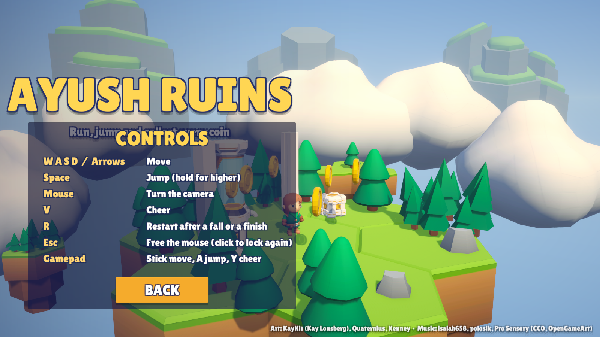

# 🏝️ Ayush Ruins

**A cozy 3D platformer made in Unity 6.** Run and jump across floating sky islands, collect every coin, then light the ancient flame pillars to open the teleporter. Level 2 takes the adventure into space — with lower gravity, fast moving cubes and a four-part flame quest.

### ▶️ [Play it in your browser](https://ayushpankaj20-tech.github.io/ayush-ruins/)
*(Desktop browser recommended — keyboard & mouse, or a gamepad.)*



---

## 🎮 Gameplay

| | |
|---|---|
|  |  |
| **Level 1 – Sky Islands.** Grassy floating islands, a mountain skyline and ancient sci‑fi ruins. | **Flame quest.** Once every coin is collected, two flame paths come alive — ride the moving cube or climb the steps. |
|  |  |
| **Light the pillars** with the flames to open the teleporter. | **Level 2 – Space Station.** Hover pads, planets, moons and a higher jump in low gravity. |
|  |  |
| **Four coloured flames, one at a time** — blue, green, purple and a hidden golden flame. | **Ride 9 moving cubes down** beneath the station to the hidden pillar. |

### How a level works
1. **Collect all the coins** — the counter is in the top-left corner.
2. The screen fades and the **flame quest** begins. The objective at the top of the screen always tells you what to do next.
3. Pick up each flame and **bring it to its pillar**.
4. When every pillar is lit, **step into the teleporter** — and celebrate!

Falling off the islands shows *You Died* and respawns you. Once the flame quest has started you respawn at the pillars and keep your coins.

## ⌨️ Controls

| Key | Action |
|---|---|
| **W A S D / Arrow keys** | Move (relative to the camera) |
| **Space** | Jump — hold for a higher jump |
| **Mouse** | Rotate the camera |
| **V** | Cheer! |
| **R** | Restart right away after falling or finishing |
| **Esc** | Free the mouse cursor (click to lock it again) |
| **Gamepad** | Left stick move · A jump · Right stick camera · Y cheer |



## ✨ Features

- **Third-person controller** — camera-relative movement, coyote time, jump buffering, variable jump height and snappy gravity.
- **Animated character** — idle, walk, run, jump, fall, land and a cheer emote driven by an Animator state machine.
- **Smooth follow camera** that pulls in instead of clipping through platforms.
- **Moving platforms** that carry the player.
- **Staged quest system** — routes stay visible but frozen until unlocked, then open one stage at a time with a fade transition, banners and an on-screen objective tracker.
- **Coins, colour-coded flames and pillars**, checkpoints, death & respawn, level transitions and a main menu with a controls screen.
- **Stylized look** — URP with soft shadows, a custom gradient skybox shader, bloom, colour grading, vignette and fog.
- **Seamless looping music** with automatic silence trimming and crossfade.

## 🛠️ Built with

- **Unity 6** (6000.6) · **Universal Render Pipeline** · **C#**
- **Input System** (keyboard, mouse and gamepad)
- Developed with AI assistance — **Claude** (Anthropic) working inside Unity through Unity's official **MCP / Unity CLI** tools.

## 📁 Project structure

```
Assets/
├── Scenes/          MainMenu, Level01, Level02
├── Scripts/         Gameplay code (see below)
├── Prefabs/         Player, Coin, platforms, flames, FX
├── Materials/       Materials, textures and the gradient skybox shader
├── Settings/        URP and post-processing profiles
└── ImportedAssets/  Third-party art, fonts, sounds and music (see Credits)
docs/                WebGL build (served by GitHub Pages)
Media/               Screenshots for this README
```

**Key scripts:** `PlayerController` · `PlayerAnimation` · `PlayerSounds` · `PlayerEmote` · `ThirdPersonCamera` · `MovingPlatform` · `CoinPickup` · `ScoreManager` · `ScoreUI` · `FlameObjective` · `FlamePickup` · `FlamePillar` · `FlamePortal` · `GoalZone` · `KillZone` · `GameManager` · `SceneLoader` · `MusicPlayer` · `MainMenu`

## 🚀 Run it yourself

1. Install **Unity 6** (6000.6.x) with **Web** build support from Unity Hub.
2. Clone this repository and open the folder in Unity Hub (**Add → Add project from disk**).
3. Open `Assets/Scenes/MainMenu.unity` and press **Play**.

To make a web build: **File → Build Profiles → Web → Build**, then copy the output into `docs/`.

## 🙏 Credits

All third-party assets are free to use:

| Asset | Author | License |
|---|---|---|
| Character Pack: Adventurers, Medieval Hexagon Pack | [Kay Lousberg (KayKit)](https://kaylousberg.itch.io/) | CC0 |
| Ultimate Modular Sci-Fi Pack | [Quaternius](https://quaternius.com/) | CC0 |
| Starter Kit 3D Platformer (sounds) | [Kenney](https://kenney.nl/) | MIT / CC0 |
| Lilita One font | Juan Montoreano | SIL Open Font License |
| "Slow Stride" | isaiah658 – [OpenGameArt](https://opengameart.org/content/slow-stride) | CC0 |
| "Simple menu/background music loop" | polosik – [OpenGameArt](https://opengameart.org/content/simple-menubackground-music-loop) | CC0 |
| "chill" | Pro Sensory – [OpenGameArt](https://opengameart.org/content/chill-1) | CC0 |

---

Made by **[Ayush](https://github.com/ayushpankaj20-tech)** — thanks for playing! ⭐ Star the repo if you enjoyed it.
